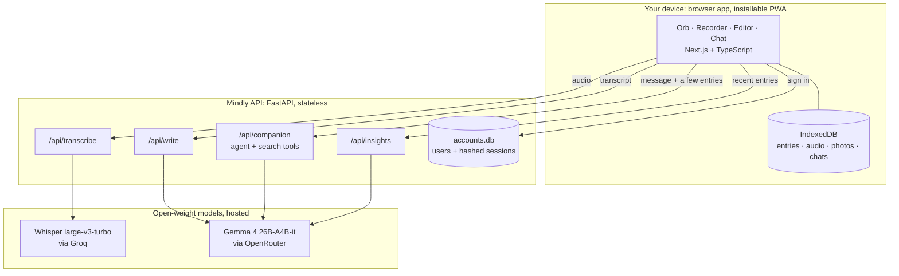
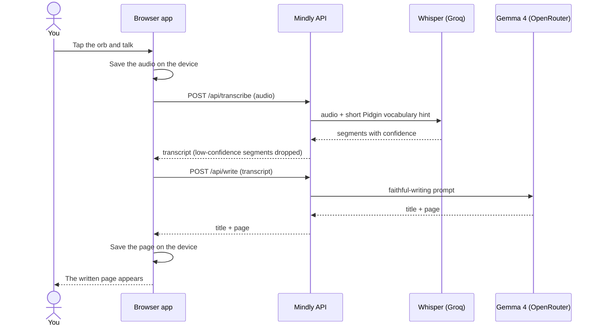

# Architecture

Mindly is a small, stateless API in front of two hosted open-weight models, plus a web app that keeps each person's journal on their own device. The design goal is simple to run, safe by default, and able to grow by changing configuration before changing code.

Arrows show requests; each reply returns along the same path. Your journal stays in IndexedDB on the device. The server keeps only accounts, and the models see text and audio only while a request is being answered.

A note's path, from voice to page:

## The web app

- **Static export.** Next.js builds to plain files (`frontend/out`) that the API serves, so the whole product is one container.
- **One codebase, three layouts.** Under 700 px it is the original phone layout. From 700 px a roomier single column. From 1100 px a shell (`components/Shell.tsx`) puts the journal in a sidebar and opens Home, an entry, Chat, Insights and Settings in the pane beside it. On narrow screens the shell's wrappers are `display: contents`, so nothing changes. On desktop the pane is a containing block, so the fixed recording orb, composer and floating buttons centre on the pane instead of the window.
- **The voice dock** (`components/VoiceDock.tsx`) measures its anchor against the pane, supports tap-to-pause on the orb, and listens for keyboard shortcuts (Space, Enter, Esc) when no text field has focus.
- **A landing page** for signed-out visitors on tablet and desktop (`app/welcome/page.tsx`); phones keep the original splash. Social previews use Open Graph tags and a PNG image (`public/og.png`) because most chat apps ignore SVG icons.
- **Offline.** A service worker caches pages and assets as they load (network first) so Mindly opens and records without a connection.

## Tenancy: one account, one private journal

- **A tenant is an account.** Everything personal is partitioned by account id.
- **Journals never live on the server.** Entries, audio and conversations are stored in the browser's IndexedDB, in a database named for the account id, so two people sharing a device don't see each other's journal. The server holds only identity: email, name, a scrypt password hash (or a Google subject id), onboarding answers, and hashed session tokens.
- **The AI endpoints are stateless.** A request carries the few entries it needs and the server forgets them when it responds. There is no per-tenant data to migrate, back up, leak or delete on the server (except the account itself, which `DELETE /api/me` removes).
- **Per-tenant limits.** `DAILY_AI_LIMIT` caps AI calls per account per day, so one account can't spend the whole API budget.

## What leaves the device, and when

| Action | Sent | To | Kept |
|---|---|---|---|
| Record | the audio file | this API, then the Whisper host | deleted straight after transcription |
| Write the page | the transcript (and the prompt you answered) | this API, then the language model | no |
| Reflect / Talk | your message, the entry being read, and up to ~30 relevant or recent entries, each trimmed | this API, then the language model | no |

The browser decides which entries a chat request carries (`frontend/lib/context.ts`: the entry being read, the entries most like the conversation, and the latest few, each trimmed to 1,200 characters). That keeps requests small and fast, and sends as little of a journal as a reply needs.

## Security

| Concern | What we do |
|---|---|
| Passwords | scrypt with a per-user salt; minimum length enforced; sign-in throttled per email and per IP |
| Sessions | random 256-bit token in an `HttpOnly`, `SameSite=Lax` cookie (`Secure` over HTTPS); only a SHA-256 hash is stored; 30-day expiry; sign-out deletes it |
| Cross-site requests | `SameSite=Lax` plus an `Origin` check that refuses state-changing API calls from another site |
| Google sign-in | the ID token is verified with Google: audience, issuer, expiry and verified email |
| Browser hardening | Content-Security-Policy (no framing, same-origin connections plus Google sign-in), `nosniff`, `Referrer-Policy`, `Permissions-Policy` (microphone for this site only) |
| Caching | API responses are `Cache-Control: no-store`; app pages are revalidated on every load so a new deploy shows up at once; hashed asset files are cached for a year |
| Model providers | On OpenRouter, requests are restricted to providers that don't collect or train on prompts (`LLM_DENY_DATA_COLLECTION`, on by default). Don't enable OpenRouter's "Broadcast" trace export: it would copy prompts, which contain journal text, to a third-party tool |
| Abuse | audio capped at 25 MB; JSON bodies bounded; chat context capped at 400 KB; per-account daily AI quota |
| Prompt injection | transcripts and journal text are passed as delimited data (we tested an entry that says "ignore all previous instructions"; the model ignored it); the model cannot reach anything except two read-only search tools over the entries it was sent; every citation it makes is checked against entries it was actually shown, in `[#n]` or `[n]` form |
| Secrets | environment variables only; `.env` is git-ignored; the API never logs request bodies |
| Safety | crisis language adds a support card with Nigerian helplines; the companion has a written protocol and refuses to act as a general assistant |
| API surface | `/docs` and `/openapi.json` are disabled |

Known gaps (see the README's limitations): the app lock is a screen lock, not encryption at rest; the journal is tied to one browser until encrypted sync exists.

## Speech and writing quality

- **A vocabulary hint for the speech model.** Every hosted transcription carries a short prompt ("Nigerian English and Pidgin: abeg, wahala, dey, wetin, oga."). In a test clip this changed "a beg ... I day try" into "abeg ... I dey try". A longer prompt made Whisper invent sentences from pure noise, so it is kept short.
- **Confidence filter.** Segments with an average log-probability below -1.3 are dropped. Invented text from noise scored about -1.8; real speech about -0.3. Silent or noisy recordings come back empty and the app says "no words came through".
- **The writer fixes only the obvious.** It corrects clear recognition slips (homophones, broken words, times like "two thirty") and keeps the person's most-used spelling of a name, but never guesses a name, number or place, and drops artefacts such as "Thank you for watching".

## Latency

The path a note takes is **record → upload → transcribe → write → show**. The hosted figures below were measured on 29 October 2026 with a 44-second note over a home connection, against the real services; the on-server figure is an estimate. Expect more variation on mobile data and at busy times.

| Step | Hosted (default when `ASR_API_KEY` is set) | On the server's CPU |
|---|---|---|
| Upload (32 kbps ≈ 240 KB) | ~0.5–1.5 s on mobile data | same |
| Transcribe | **0.9–1.2 s warm** (Whisper large-v3-turbo on Groq; 3–8 s for the very first request after a restart) | ~15–30 s (estimate; Whisper small, int8) |
| Write the page | **median ~3 s** (Gemma 4 26B-A4B; individual calls ranged 1.5–15 s depending on which provider served them) | same |
| **After you tap Done** | **~4–6 s typically** | **~20–35 s** |

What is already in place: a lower recording bitrate; persistent keep-alive connections to the speech and language services (no TLS handshake per request); transcription starts the moment recording ends; the write step starts the moment the transcript arrives; and all steps are saved on the device first, so a dropped connection resumes instead of restarting.

Next, in order of impact:

1. **Transcribe while the person is still talking.** Cut the recording into self-contained chunks every ~15 s (PCM or Opus, no gaps), upload each as it is finished, and transcribe in parallel. Time after Done then drops to "last chunk + write", roughly 1–2 s.
2. **Show the transcript immediately as a draft** and swap in the written page when it arrives, so words are on screen at the end of the speech step rather than after the language model.
3. **Stream the writing step** like the chat reply already is.
4. **Run the API near the user** (see DEPLOYMENT.md) and keep one machine always warm so there are no cold starts.
5. **A smaller writing model** (8–12B class) as an option, trading some fidelity for speed.

## Chat

The companion's reply is streamed as newline-delimited JSON, so the first words appear in about a second (measured 0.6–1.3 s, with the whole reply done in 1.6–2.2 s) instead of after the full reply. The user's message is saved and shown before the request starts; the reply is capped at 500 tokens; related entries are found with a small in-memory full-text index built per request (Porter stemming, so "exams" finds "exam"), so the model usually answers on the first round without using tools; and if it does call a tool, the draft is reset and the final answer replaces it with citations checked.

## How it runs today

One AWS EC2 instance (t4g.small, Ubuntu, in the account's Region) runs the Docker image and Caddy, which gets and renews the HTTPS certificate. The accounts database is on the instance's encrypted 20 GiB disk. Updating is `git archive HEAD | ssh ... tar -x` followed by `docker compose up -d --build`. See [AWS-SETUP.md](AWS-SETUP.md).

## Reliability

The app depends on two hosted services (speech and language), so the first rule is that a hiccup there shouldn't reach the person.

- **Retries.** A timeout, dropped connection, rate limit (429) or server error (5xx) from the speech or language service is retried twice with a short backoff (0.4 s, then 1.2 s). A wrong key or a bad request is not retried, because trying again can't fix it.
- **A fallback model.** If the main model still fails, the request goes to `LLM_FALLBACK_MODEL` (Gemma 4 31B-it, same family and licence, so the prompts behave the same) or `ASR_FALLBACK_MODEL` (Whisper large-v3). Both are optional settings.
- **Streaming.** A chat reply that fails before any words are sent is retried; one that fails halfway is not, because that would repeat words the person has already read.
- **Nothing is lost.** Recordings are saved on the device before anything is sent, a failed step shows "Try again" with the recording kept, and an offline recording is queued and resumed when the connection returns.
- **The server.** Both containers restart automatically, Docker starts at boot, a health check watches the app, container logs are size-limited, and the operating system installs security updates.
- **What isn't covered.** One server is a single point of failure, there is no automatic alert when it goes down, and the accounts database isn't backed up off the machine (the journals aren't on the server at all).

## Scaling path

Today it runs as one container with SQLite for accounts. Nothing is stateful except that database and the in-memory rate limiter, so:

1. **One machine, vertical.** Enough for thousands of accounts; the AI work happens on hosted services, not the API machine.
2. **More machines.** Move accounts from SQLite to Postgres (the whole surface is `mindly/accounts.py`) and the rate limiter to Redis (`Limiter` in `main.py`); then run any number of identical containers behind a load balancer.
3. **Self-host the models** when volume justifies it: point `LLM_BASE_URL` and `ASR_BASE_URL` at vLLM or any OpenAI-compatible server. No application code changes.
4. **Optional encrypted sync** for the journal (end-to-end, keys derived on the device) to lift the one-browser limit without giving the server readable data.
